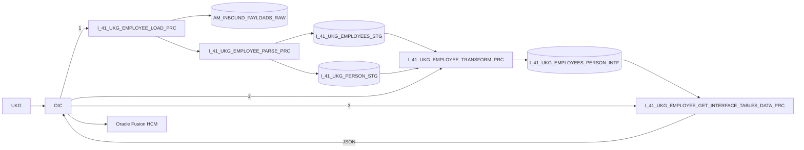

# AM_41_UKG_EMPLOYEE_TO_HCM_PKG

Package PL/SQL (Oracle Database) da integração **INT41 — UKG → Oracle Fusion HCM**. Recebe o payload JSON de funcionários e pessoas enviado pelo UKG através do **Oracle Integration Cloud (OIC)**, grava em tabelas de staging, valida, transforma para o layout do Oracle HCM e devolve o JSON final para o OIC enviar ao Fusion.

> Arquivo: `newPackageBody.sql` (somente o *package body*; a *specification* deve estar versionada junto).

---

## Sumário

- [Visão geral do fluxo](#visão-geral-do-fluxo)
- [Procedures](#procedures)
- [Tipos de documento (DOC_TYPE)](#tipos-de-documento-doc_type)
- [Controle de status (PROCESSED_FLAG)](#controle-de-status-processed_flag)
- [Objetos de banco utilizados](#objetos-de-banco-utilizados)
- [Mapeamento JSON → Staging](#mapeamento-json--staging)
- [Validações](#validações)
- [Regras de transformação](#regras-de-transformação)
- [Tratamento de erros](#tratamento-de-erros)
- [Exemplo de execução](#exemplo-de-execução)
- [Pontos de atenção conhecidos](#pontos-de-atenção-conhecidos)

---

## Visão geral do fluxo



1. **LOAD** — grava o payload bruto e dispara o **PARSE**.
2. **TRANSFORM** — valida os dados de staging e monta a tabela de interface (chamada em lotes até `O_P_HAS_MORE_COUNT = 0`).
3. **GET_INTERFACE_TABLES_DATA** — gera o JSON com os registros prontos para envio ao HCM.

---

## Procedures

### `I_41_UKG_EMPLOYEE_LOAD_PRC`

Ponto de entrada. Insere o payload em `AM_INBOUND_PAYLOADS_RAW`, faz `COMMIT` e chama `I_41_UKG_EMPLOYEE_PARSE_PRC`.

| Parâmetro | Tipo | Descrição |
|---|---|---|
| `I_P_OIC_ID` | IN VARCHAR2 | ID da instância do OIC |
| `I_P_STARTER_ID` | IN VARCHAR2 | ID da instância *starter* do OIC |
| `I_P_FILE_NAME` | IN VARCHAR2 | Nome do arquivo/payload recebido |
| `I_P_CONTENT` | IN CLOB | Payload JSON (array) |
| `I_P_SOURCE_SYSTEM` | IN VARCHAR2 | Sistema de origem |
| `I_P_DOC_TYPE` | IN VARCHAR2 | `INT41E` (employee) ou `INT41P` (person) |
| `O_P_RESPONSE` | OUT CLOB | Log textual da execução |
| `O_P_STATUS` | OUT VARCHAR2 | `SUCCESS` ou `ERROR` |

### `I_41_UKG_EMPLOYEE_PARSE_PRC`

Lê o payload (`SELECT ... FOR UPDATE NOWAIT`, somente `processed_flag = 'N'` e `doc_type` igual ao informado), marca como `P`, percorre o array JSON com `JSON_TABLE` e insere cada elemento na tabela de staging correspondente. Ao final marca o payload como `Y`.

| Parâmetro | Tipo | Descrição |
|---|---|---|
| `I_P_OIC_ID` | IN VARCHAR2 | ID da instância do OIC (opcional) |
| `p_starter_instance_id` | IN VARCHAR2 | ID da instância *starter* (opcional) |
| `p_payload_rec_id` | IN NUMBER | `PAYLOAD_REC_ID` do registro em `AM_INBOUND_PAYLOADS_RAW` |
| `I_P_DOC_TYPE` | IN VARCHAR2 | `INT41E` ou `INT41P` |
| `O_P_STATUS` | OUT VARCHAR2 | `SUCCESS` ou `ERROR` |
| `O_P_RESPONSE` | OUT CLOB | Mensagem de resultado |

Erros de negócio levantados:

| Código | Situação |
|---|---|
| `-20001` | `PAYLOAD_DATA` nulo |
| `-20003` | Elemento do array sem `EmployeeNumber` (INT41E) ou sem `EmployeeId` (INT41P) |
| `-20010` | Payload não encontrado, já processado ou `DOC_TYPE` divergente |
| `-54` | Registro bloqueado por outra sessão (`e_resource_busy`) |

### `I_41_UKG_EMPLOYEE_TRANSFORM_PRC`

Executa as validações nas tabelas de staging e transforma os registros pendentes (`PROCESSED_FLAG = 'N'`) em linhas de `I_41_UKG_EMPLOYEES_PERSON_INTF`, juntando funcionário + pessoa + *lookups* de cargo e departamento + dados existentes no Fusion (`PER_PEOPLE_ALL_PVO_INTF`).

| Parâmetro | Tipo | Descrição |
|---|---|---|
| `I_P_OIC_ID` | IN VARCHAR2 | Filtra os registros de staging da instância do OIC |
| `O_P_RESPONSE` | OUT CLOB | Log da execução |
| `O_P_STATUS` | OUT VARCHAR2 | `SUCCESS` ou `ERROR` |
| `O_P_HAS_MORE_COUNT` | OUT NUMBER | Quantidade de registros ainda com flag `N` (o OIC repete a chamada enquanto for > 0) |

Limite por execução: `l_v_MAX_RECORDS_PER_RUN = 250`.

### `I_41_UKG_EMPLOYEE_GET_INTERFACE_TABLES_DATA_PRC`

Gera um JSON `{ "Records": [ ... ] }` com todos os registros de `I_41_UKG_EMPLOYEES_PERSON_INTF` com `PROCESSED_FLAG = 'Y'`.

| Parâmetro | Tipo | Descrição |
|---|---|---|
| `O_P_RESPONSE` | OUT CLOB | Log da execução |
| `O_P_JSON` | OUT CLOB | JSON gerado |
| `O_P_STATUS` | OUT VARCHAR2 | `SUCCESS` ou `ERROR` |
| `O_P_HAS_MORE_COUNT` | OUT NUMBER | Atualmente sempre `0` |

---

## Tipos de documento (DOC_TYPE)

| DOC_TYPE | Conteúdo | Tabela de staging |
|---|---|---|
| `INT41E` | Dados de emprego/assignment (employee) | `I_41_UKG_EMPLOYEES_STG` |
| `INT41P` | Dados pessoais (person) | `I_41_UKG_PERSON_STG` |

Cada tipo é enviado em um payload separado (array JSON na raiz: `[ {...}, {...} ]`).

---

## Controle de status (PROCESSED_FLAG)

| Flag | Significado |
|---|---|
| `N` | Novo / pendente |
| `P` | Em processamento |
| `Y` | Processado com sucesso |
| `E` | Erro (ver `ERROR_CODE` / `ERROR_MESSAGE`) |

Usado em `AM_INBOUND_PAYLOADS_RAW`, `I_41_UKG_EMPLOYEES_STG`, `I_41_UKG_PERSON_STG` e `I_41_UKG_EMPLOYEES_PERSON_INTF`.

---

## Objetos de banco utilizados

| Objeto | Uso |
|---|---|
| `AM_INBOUND_PAYLOADS_RAW` | Payloads brutos recebidos |
| `I_41_UKG_EMPLOYEES_STG` | Staging de funcionários |
| `I_41_UKG_PERSON_STG` | Staging de pessoas |
| `I_41_UKG_EMPLOYEES_PERSON_INTF` | Interface final (funcionário + pessoa) |
| `I_41_JOB_CODE_UKG_TO_ORACLE_LKP` | De/para de cargo (`UKG_JOB_CODE` → `ORACLE_JOB_CODE`) |
| `I_41_DEPT_NAME_UKG_TO_ORACLE_LKP` | De/para de departamento (`UKG_DEPARTMENT_NAME` → `ORACLE_DEPARTMENT_NAME`) |
| `PER_PEOPLE_ALL_PVO_INTF` | Pessoas já existentes no Fusion (define HIRE vs. demais ações) |

---

## Mapeamento JSON → Staging

### INT41E → `I_41_UKG_EMPLOYEES_STG`

| Campo JSON | Coluna |
|---|---|
| `id` | `SOURCE_DOC_ID` |
| `EmployeeId` | `EMPLOYEE_ID` |
| `EmployeeNumber` | `EMPLOYEE_NUMBER` |
| `HireDate` | `HIRE_DATE` |
| `OriginalHireDate` | `REHIRE_DATE` |
| `TerminationDate` | `TERMINATION_DATE` |
| `JobCode` | `JOB_CODE` |
| `DepartmentName` | `DEPARTMENT_CODE` |
| `CompanyCodeLegalEmployer` | `COMPANY_CODE_LEGAL_EMPLOYER` |
| `WorkerType` | `WORKER_TYPE` |
| `ActionCode` | `ACTION_CODE` |
| `BusinessUnitName` | `BUSINESS_UNIT_NAME` |
| `DefaultExpenseAccount` | `DEFAULT_EXPENSE_ACCOUNT` |
| `ManagerAssignmentNumber` | `MANAGER_ASSIGNMENT_NUMBER` |
| `okToRehire` | `OK_TO_REHIRE` |
| `jobChangeReasonCode` | `EMPLOYEE_CHANGE` |
| `statusStartDate` | `START_DATE` |
| `assignmentDate` | `ASSIGNMENT_DATE` |
| `dateTimeChanged` | `DATE_TIME_CHANGED` |

### INT41P → `I_41_UKG_PERSON_STG`

| Campo JSON | Coluna |
|---|---|
| `id` | `SOURCE_DOC_ID` |
| `EmployeeId` | `EMPLOYEE_ID` |
| `FirstName` | `FIRST_NAME` |
| `LastName` | `LAST_NAME` |
| `KnownAs` | `KNOWN_AS` |
| `Suffix` | `SUFFIX` |
| `DateOfBirth` | `DATE_OF_BIRTH` |
| `EmailAddress` | `EMAIL_ADDRESS` |
| `NationalIdentifier` | `NATIONAL_ID` |
| `addressCountry` | `HOME_ADRESS_COUNTRY` |
| `dateTimeChanged` | `DATE_TIME_CHANGED` |

Todos os campos são gravados como texto (`VARCHAR2(400)`); campos ausentes ou inválidos viram `NULL` (`NULL ON ERROR`).

---

## Validações

Executadas no início do `TRANSFORM`. Registros reprovados recebem `PROCESSED_FLAG = 'E'`, `ERROR_CODE = '400'` e a mensagem correspondente (mensagens podem ser concatenadas com ` | `).

| Tabela | Regra | Mensagem |
|---|---|---|
| EMPLOYEES_STG | `HIRE_DATE` ou `JOB_CODE` nulo | Mandatory fields missing - Hire date or Job code |
| PERSON_STG | `FIRST_NAME`, `LAST_NAME` ou `DATE_OF_BIRTH` nulo | Mandatory fields missing - Name or Date of birth |
| PERSON_STG | Idade mínima (216 meses = 18 anos) | Minimum age not reached |
| EMPLOYEES_STG | Data de contratação anterior ao nascimento | Hire date earlier than date of birth |
| EMPLOYEES_STG | Data de desligamento anterior à contratação | Termination date earlier than hire date |

---

## Regras de transformação

- **`EMPLOYEE_CHANGE`** (ação enviada ao HCM):
  - `T` → `TERM`
  - pessoa não existe no Fusion (`PER_PEOPLE_ALL_PVO_INTF`) → `HIRE`
  - possui `TERMINATION_DATE` e `HIRE_DATE` > `TERMINATION_DATE` → `REHIRE`
  - `A` → `UPDATE`
  - demais casos → valor original
- **`BUSINESS_UNIT_NAME`**: `UR` → *United Rotorcraft*; `Tour` → *Blue Hawaiian*; qualquer outro → *Air Methods*.
- **`LEGAL_EMPLOYER_NAME`**: `Contractors%Temp` → *Air Methods LLC*; senão, `COMPANY_CODE_LEGAL_EMPLOYER`.
- **`ASSIGNMENT_NUMBER`**: `'E' || EMPLOYEE_NUMBER`.
- **`JOB_CODE`** e **`DEPT_DESC`**: obtidos pelos *lookups* de de/para.
- **Fixos**: `LEGISLATION_CODE = 'US'`, `ASSIGNMENT_STATUS_TYPE_CODE = 'ACTIVE_NO_PROCESS'`, `ASSIGNMENT_STATUS = 'ACTIVE'`, `MANAGER_TYPE = 'LINE_MANAGER'`, `HOME_ADRESS_COUNTRY = 'US'`, `LOCATION_CODE = NULL`.

---

## Tratamento de erros

- Todas as procedures retornam `O_P_STATUS` (`SUCCESS`/`ERROR`) e um log em `O_P_RESPONSE`, incluindo `SQLCODE`, `SQLERRM` e *backtrace*.
- **PARSE**: em erro faz `ROLLBACK`, grava `processed_flag = 'E'` com `error_code`/`error_message` em `AM_INBOUND_PAYLOADS_RAW` e relança a exceção.
- **TRANSFORM**: em erro marca o registro de staging como `E`, remove a linha parcial da interface e relança a exceção.
- **GET_INTERFACE_TABLES_DATA**: não relança; apenas retorna `O_P_STATUS = 'ERROR'`.

---

## Exemplo de execução

```sql
DECLARE
    l_response  CLOB;
    l_status    VARCHAR2(32);
    l_json      CLOB;
    l_more      NUMBER;
BEGIN
    -- 1) Carga + parse (employee)
    AM_41_UKG_EMPLOYEE_TO_HCM_PKG.I_41_UKG_EMPLOYEE_LOAD_PRC(
        I_P_OIC_ID        => 'TEST_SQLDEV',
        I_P_STARTER_ID    => 'TEST_SQLDEV',
        I_P_FILE_NAME     => 'employees_20261113.json',
        I_P_CONTENT       => '[{"EmployeeId":"1","EmployeeNumber":"1001","HireDate":"2026-01-10","JobCode":"X"}]',
        I_P_SOURCE_SYSTEM => 'UKG',
        I_P_DOC_TYPE      => 'INT41E',
        O_P_RESPONSE      => l_response,
        O_P_STATUS        => l_status
    );

    -- 2) Transformação (repetir enquanto l_more > 0)
    AM_41_UKG_EMPLOYEE_TO_HCM_PKG.I_41_UKG_EMPLOYEE_TRANSFORM_PRC(
        I_P_OIC_ID         => 'TEST_SQLDEV',
        O_P_RESPONSE       => l_response,
        O_P_STATUS         => l_status,
        O_P_HAS_MORE_COUNT => l_more
    );

    -- 3) JSON para o HCM
    AM_41_UKG_EMPLOYEE_TO_HCM_PKG.I_41_UKG_EMPLOYEE_GET_INTERFACE_TABLES_DATA_PRC(
        O_P_RESPONSE       => l_response,
        O_P_JSON           => l_json,
        O_P_STATUS         => l_status,
        O_P_HAS_MORE_COUNT => l_more
    );
END;
/
```

---

## Pontos de atenção conhecidos

Consulte a Issue associada para o detalhamento. Resumo:

- `TRANSFORM` possui `OIC_INSTANCE_ID = 'TEST_SQLDEV'` fixo na validação *Hire date earlier than date of birth*.
- `LOAD_PRC` sobrescreve `O_P_RESPONSE` (`:=` em vez de `||`) e mantém uma linha de *test print*.
- O limite de 250 registros por execução não é respeitado de fato (cursor interno processa todos os pendentes).
- O `DELETE` do tratamento de exceção do `TRANSFORM` compara colunas diferentes.
- Blocos de código comentado e variáveis não utilizadas devem ser removidos.

---

## Observações de segurança

As tabelas de staging e o payload bruto armazenam dados pessoais (data de nascimento, e-mail, `NATIONAL_ID`). Defina política de retenção/expurgo e restrinja o acesso às tabelas `AM_INBOUND_PAYLOADS_RAW` e `I_41_UKG_PERSON_STG`.
